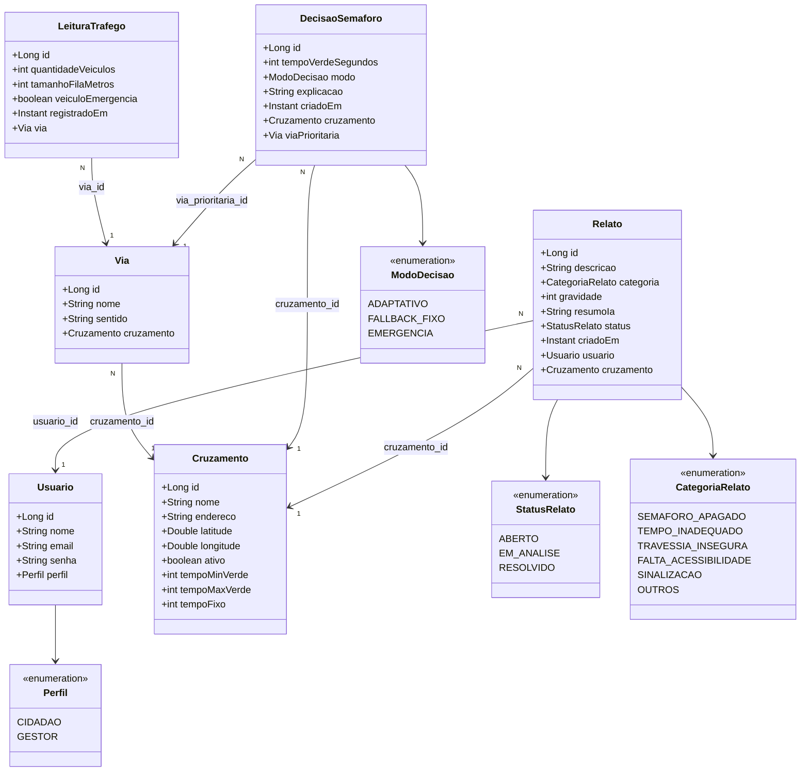
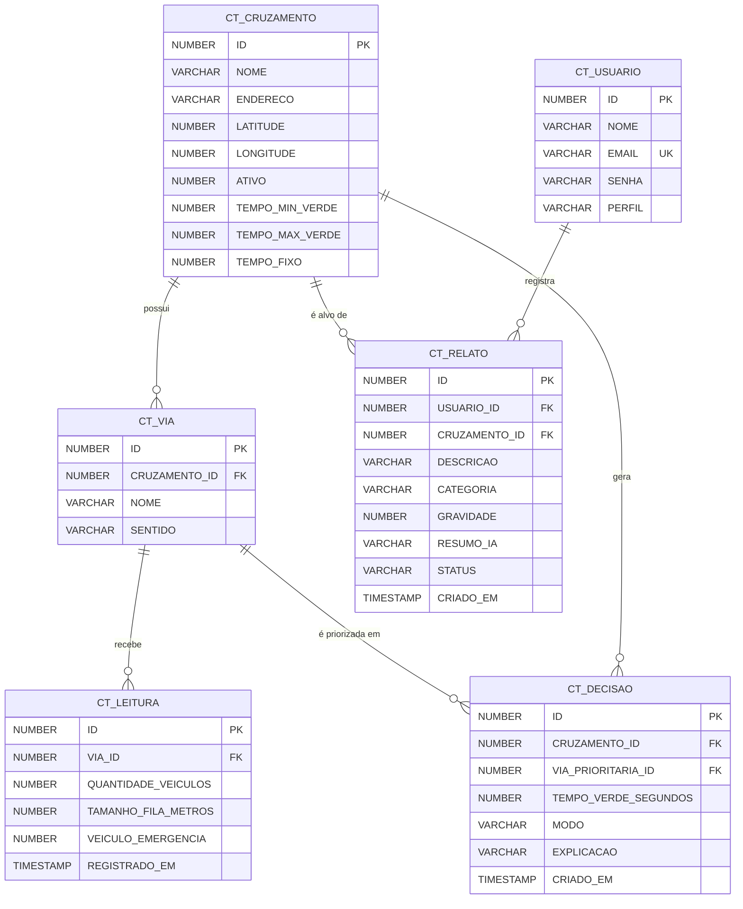

# 🚦 Semáforo Inteligente — CitizenTech

Backend desenvolvido com Java e Spring Boot para a **Global Solution 2026 2°SEM FIAP**.
O sistema recebe leituras de sensores de trânsito (quantidade de veículos e tamanho da fila por via), decide qual via abrir e por quanto tempo, e **explica a decisão ao cidadão com IA generativa (Spring AI)**. O cidadão também pode **reportar problemas** no cruzamento (semáforo apagado, travessia insegura, falta de acessibilidade), que a IA classifica e prioriza para o gestor de trânsito.

A mesma API é consumida pelo app Mobile (React Native) da solução e oferece:

- **API RESTful** protegida por **JWT**, com dois perfis (`CIDADAO` e `GESTOR`) e documentada com Swagger.
- **Mensageria com RabbitMQ**: as leituras são publicadas como evento e processadas de forma assíncrona.
- **IA generativa (Spring AI)** integrada ao fluxo: explica cada decisão do semáforo e classifica os relatos dos cidadãos.
- **Painel de testes** (Thymeleaf) em `/dev`, para simular sensores e testar o fluxo inteiro sem montar requisições à mão.

---

## 🎯 O problema e o cidadão

Semáforos de tempo fixo dão o mesmo tempo de verde para uma rua vazia e para uma avenida congestionada, o que gera **horas perdidas no trânsito**, mais poluição e atraso para quem precisa de passagem rápida.

**Quem é beneficiado:** motoristas, motociclistas, passageiros de transporte público, pedestres e serviços de emergência.

**Como a solução ajuda:**

- O semáforo se adapta à demanda real de cada via e dá prioridade a veículos de emergência.
- Se um sensor sai do ar, o sistema volta sozinho ao tempo fixo (modo seguro), sem "congelar" o cruzamento.
- O cidadão **vê a situação do cruzamento e entende o motivo da decisão** em linguagem simples.
- O cidadão **reporta problemas** e o gestor recebe a fila de relatos já classificada por categoria e gravidade.

**ODS relacionado:** ODS 11 — Cidades e comunidades sustentáveis.

---

## 👥 MoveSync — 2TDSPO

--------------------------------
|         Nome        |   RM   |
|---------------------|--------|
| Bruno A Zanateli    | 563736 |
| Christian S Freitas | 566098 |
| Pedro P Biasolli    | 562521 |
| Rodrigo Tiezzi      | 562975 |
| Maheus E Souza      | 562532 |
--------------------------------

---

## 🔗 Links

| Item | Link                                  |
|------|---------------------------------------|
| Repositório | https://github.com/Bruno-A-Z/MoveSync |
| Vídeo pitch (até 5 min) | ...                                   |
| Deploy  | ...                                   |

---

## 🛠️ Tecnologias Utilizadas

| Tecnologia | Versão / Detalhe |
|------------|------------------|
| Java | 21 |
| Spring Boot | 3.4.5 |
| Spring Data JPA | gerenciado pelo Spring Boot |
| Spring Security + JWT (jjwt) | jjwt 0.12.6 |
| Spring AI (OpenAI-compatível) | 1.0.0 — configurado para o Gemini via endpoint compatível |
| Spring AMQP (RabbitMQ) | gerenciado pelo Spring Boot |
| Thymeleaf | gerenciado pelo Spring Boot (painel `/dev`) |
| H2 | banco em memória (padrão, para desenvolvimento) |
| Oracle Database | driver `ojdbc11` (perfil `oracle`) |
| SpringDoc OpenAPI (Swagger) | 2.8.6 |
| Bean Validation | gerenciado pelo Spring Boot |
| Lombok | gerenciado pelo Spring Boot |
| JUnit 5 + Spring Security Test | testes |
| Maven | 3.9+ |
| Docker / Docker Compose | RabbitMQ (compose) e imagem da API (Dockerfile multi-stage) |

---

## 🏗️ Arquitetura

O projeto segue a arquitetura em camadas, com uma parte distribuída por mensageria (**opção A do requisito 5 — RabbitMQ**):

```
Controller → Service → Repository → Banco de dados
```

```
ESP32 / simulador ──MQTT──► RabbitMQ (amq.topic, sensores.#) ─┐
                                                              ├─► fila trafego.leituras ─► LeituraConsumer
API REST  POST /api/leituras ──► trafego.exchange ────────────┘        │
                                                                       ▼
                                  TrafegoService: salva leitura → MotorDecisao → grava DecisaoSemaforo
                                                                       │
                                                                       ├─► IaService (@Async): LLM troca a explicação padrão
                                                                       ▼
        App do cidadão / painel do gestor  ◄── GET /api/cruzamentos/{id}/status
```

O mesmo consumidor atende o REST e o MQTT: o plugin MQTT do RabbitMQ converte o tópico `sensores/1/2` na routing key `sensores.1.2`, que cai na mesma fila `trafego.leituras`.

```
semaforo-inteligente/
├── src/main/java/com/citizentech/semaforo/
│   ├── controller/      # Endpoints REST (e o painel /dev)
│   ├── service/         # Regras de negócio, MotorDecisao e TrafegoService
│   ├── repository/      # Acesso a dados (Spring Data JPA)
│   ├── domain/          # Entidades JPA e enumerações
│   ├── dto/             # DTOs de request e response (records com Bean Validation)
│   ├── ai/              # IaService (Spring AI) e ClassificacaoRelato
│   ├── messaging/       # Publisher, consumer e evento do RabbitMQ
│   ├── security/        # JWT, filtro de autenticação e tratamento de 401/403
│   ├── config/          # RabbitMQ, OpenAPI, execução assíncrona e carga inicial
│   └── exception/       # Tratamento global de erros (ApiError)
├── src/main/resources/
│   ├── application.properties
│   ├── application-oracle.properties
│   └── templates/dev/   # Painel de testes (Thymeleaf)
├── simulador/           # Simulador de sensores (substitui o ESP32)
├── docker-compose.yml   # RabbitMQ com plugins de gerenciamento e MQTT
├── dockerfiles/        # Dockerfile.api e Dockerfile.rabbitmq
├── scripts/            # infra-azure.sh, delete-infra.sh e script-bd.sql (Azure)
└── azure-pipeline.yml  # Pipeline de CI (Azure DevOps)
```

---

## 🤖 IA Generativa (Spring AI)

A funcionalidade de IA está integrada ao fluxo da solução (não é um chat solto) e roda **sempre em segundo plano**, na classe `IaService`:

| Funcionalidade | O que a IA faz |
|----------------|----------------|
| **Explicar a decisão** | Recebe o contexto do cruzamento (vias, filas, modo de operação) e escreve, em até 3 frases, por que o semáforo abriu para aquela via. |
| **Classificar o relato** | Recebe o texto do cidadão e devolve, em formato estruturado (`ClassificacaoRelato`), a **categoria**, a **gravidade** (1 a 5) e um **resumo** de até 140 caracteres para o gestor. |

**Resiliência:** a decisão do semáforo vem do `MotorDecisao` (regras), **não da IA**. A decisão e o relato são gravados na hora com um texto padrão, e o `IaService` chama o LLM em threads separadas (`iaExecutor`) para trocar esse texto. Assim, lentidão, falta de cota ou erro do provedor (503, 429) nunca atrasam a API: no pior caso o texto padrão permanece. Os logs `Decisão N: explicação atualizada pela IA` e `Relato N: classificação atualizada pela IA` confirmam que o LLM respondeu.

**Segurança no prompt:** o texto do cidadão vai ao LLM delimitado como **dado** (`<relato>...</relato>`), nunca como instrução, e a saída estruturada é validada e tem fallback.

Categorias de relato: `SEMAFORO_APAGADO`, `TEMPO_INADEQUADO`, `TRAVESSIA_INSEGURA`, `FALTA_ACESSIBILIDADE`, `SINALIZACAO`, `OUTROS`.

### Regras do `MotorDecisao`

Classe pura, coberta por testes unitários (`MotorDecisaoTest`). Em ordem de prioridade:

1. **`EMERGENCIA`** — a via com veículo de emergência (leitura recente) recebe o tempo máximo de verde.
2. **`FALLBACK_FIXO`** — se algum sensor está sem leitura recente (padrão: 120 s), o sistema volta ao tempo fixo do cruzamento e reveza as vias. O semáforo nunca depende 100% do sensor.
3. **`ADAPTATIVO`** — a demanda de cada via é `veículos + fila(m) / 6`; abre a via de maior demanda com verde proporcional à sua fatia, sempre entre `tempoMinVerde` e `tempoMaxVerde`.

Uma nova decisão é gravada a cada janela de 30 s ou quando o modo muda (por exemplo, quando entra uma emergência). A API **recomenda e registra** a decisão; ela não aciona um semáforo físico.

---

## 🔐 Segurança e Perfis de Acesso

Autenticação **stateless** com **Spring Security + JWT** (assinatura HMAC-SHA, validade de 2 horas). As senhas são armazenadas com **BCrypt**. Existem dois perfis:

| Recurso | `CIDADAO` | `GESTOR` |
|---------|:---:|:---:|
| Cadastro e login (`/api/auth/**`) | ✅ | ✅ |
| Consultar cruzamentos, vias, status e decisões | ✅ | ✅ |
| Criar, editar e excluir cruzamentos e vias | ❌ | ✅ |
| Injetar e consultar leituras de sensores | ❌ | ✅ |
| Criar relatos e ver os próprios relatos | ✅ | ❌ |
| Ver todos os relatos e mudar o status | ❌ | ✅ |

Acesso sem token ou com token inválido retorna **401**; perfil sem permissão retorna **403**, sempre em JSON padronizado. O auto-cadastro (`/api/auth/registro`) cria apenas usuários `CIDADAO`; gestores são criados diretamente na base.

### Como obter o token

```http
POST /api/auth/login
Content-Type: application/json

{
  "email": "gestor@citizentech.com",
  "senha": "Gestor@123"
}
```

Use o token retornado no cabeçalho `Authorization: Bearer <token>` das demais requisições. No Swagger, clique em **Authorize** e cole o token.

### Usuários de teste

Criados na primeira execução (se o banco estiver vazio):

| Perfil | E-mail | Senha |
|--------|--------|-------|
| `GESTOR` | `gestor@citizentech.com` | `Gestor@123` |
| `CIDADAO` | `cidadao@citizentech.com` | `Cidadao@123` |

Também é criado um cruzamento de exemplo (`id=1`, "Av. Paulista x Rua Augusta") com 3 vias (`id` 1, 2 e 3).

---

## 📊 Diagrama de Classes



---

## 🗄️ DER — Diagrama Entidade-Relacionamento

As tabelas são criadas e atualizadas pelo Hibernate (`ddl-auto=update`), com o prefixo `CT_`.



---

## 🚀 Como Rodar o Projeto

### Pré-requisitos

- **JDK 21**
- **Maven 3.9+**
- **Docker** (para o RabbitMQ) ou uma instância gratuita no CloudAMQP
- Uma **chave de API** de um provedor de IA compatível com o formato OpenAI (por padrão, o Gemini)

### Configuração

As credenciais **não ficam no código**: o `application.properties` lê tudo de variáveis de ambiente.

| Variável | Obrigatória | Descrição |
|----------|:---:|-----------|
| `OPENAI_API_KEY` | **sim** | Chave da API de IA. Com o valor `sem-chave` (ou `IA_HABILITADA=false`) a IA fica desligada e a API usa textos padrão. |
| `JWT_SECRET` | **sim** | Chave usada para assinar os tokens JWT (use **32 caracteres ou mais**). |
| `RABBITMQ_PASSWORD` | **sim** | Senha do RabbitMQ (`guest` no Docker local). |
| `RABBITMQ_HOST` | recomendada | Nome do servidor RabbitMQ, **só o host** (`localhost` no Docker local). |
| `RABBITMQ_USER` | recomendada | Usuário do RabbitMQ (`guest` no Docker local). |
| `RABBITMQ_VHOST` | recomendada | Virtual host (`/` no Docker local). |
| `RABBITMQ_PORT` | não | Porta AMQP (padrão `5672`; use `5671` com TLS). |
| `RABBITMQ_SSL` | não | `true` para conexões TLS (CloudAMQP). Padrão `false`. |
| `AI_BASE_URL` | não | URL base do provedor de IA. Padrão: `https://generativelanguage.googleapis.com`. |
| `AI_COMPLETIONS_PATH` | não | Caminho do endpoint de chat. Padrão: `/v1beta/openai/chat/completions`. |
| `OPENAI_MODEL` | não | Modelo de IA. Padrão: `gemini-3.8-flash`. |
| `IA_HABILITADA` | não | `false` desliga a IA. Padrão: `true`. |
| `PORT` | não | Porta do servidor. Padrão: `8080`. |

Exemplo (Linux/macOS) com RabbitMQ local no Docker:

```bash
export OPENAI_API_KEY=sua-chave-de-ia
export JWT_SECRET=uma-chave-longa-e-aleatoria-com-32-caracteres-ou-mais
export RABBITMQ_HOST=localhost
export RABBITMQ_USER=guest
export RABBITMQ_PASSWORD=guest
export RABBITMQ_VHOST=/
```

No Windows (PowerShell), use `$env:OPENAI_API_KEY="sua-chave"` e assim por diante.

> ⚠️ **Nunca** coloque chaves, senhas ou o `JWT_SECRET` direto no `application.properties` nem faça commit deles.

### Executando

```bash
# Clone o repositório
git clone <URL-DO-REPOSITORIO>

# Entre na pasta do projeto
cd semaforo-inteligente

# 1) Suba o RabbitMQ (AMQP 5672, painel 15672 guest/guest, MQTT 1883)
docker compose up -d

# 2) Defina as variáveis de ambiente (veja acima) e rode a API
mvn spring-boot:run

# Testes
mvn test
```

A aplicação estará disponível em:

- API: `http://localhost:8080`
- Swagger: `http://localhost:8080/swagger-ui.html`
- Painel de testes: `http://localhost:8080/dev`
- Painel do RabbitMQ: `http://localhost:15672`

Por padrão, o banco é o **H2 em memória** (os dados somem ao reiniciar) e as tabelas são criadas automaticamente.

### RabbitMQ sem Docker (CloudAMQP)

Se não for possível usar Docker, crie uma instância gratuita em [cloudamqp.com](https://www.cloudamqp.com) e use a conexão **AMQP** (não a MQTT):

1. Copie `application-local.properties.example` para `src/main/resources/application-local.properties` e preencha host, usuário, senha e vhost (porta `5671` com TLS). Esse arquivo está no `.gitignore`.
2. Rode com o profile `local`: `mvn spring-boot:run -Dspring-boot.run.profiles=local`.

Alternativa: defina `RABBITMQ_HOST`, `RABBITMQ_PORT=5671`, `RABBITMQ_SSL=true`, `RABBITMQ_USER`, `RABBITMQ_PASSWORD` e `RABBITMQ_VHOST`.

Os sensores MQTT (ESP32/simulador) só funcionam se o plugin MQTT estiver habilitado na instância; sem ele, use `POST /api/leituras`, que publica na mesma fila.

### Banco Oracle (deploy)

```bash
export DB_URL=jdbc:oracle:thin:@HOST:1521:SID
export DB_USER=seu_usuario
export DB_PASSWORD=sua_senha
mvn spring-boot:run -Dspring-boot.run.profiles=oracle
```

O Hibernate cria e atualiza as tabelas `CT_*` automaticamente.

### Executando a API com Docker

O `docker-compose.yml` sobe apenas o RabbitMQ. Para rodar a API em um container:

```bash
docker build -t semaforo-inteligente .
docker run -p 8080:8080 \
  -e RABBITMQ_HOST=<host> -e RABBITMQ_USER=<usuario> -e RABBITMQ_PASSWORD=<senha> -e RABBITMQ_VHOST=<vhost> \
  -e OPENAI_API_KEY=<chave> -e JWT_SECRET=<segredo-com-32-caracteres-ou-mais> \
  semaforo-inteligente
```

---

## 🧪 Painel de Testes — `/dev`

Página para testar o fluxo inteiro sem montar requisições à mão: **http://localhost:8080/dev**

- Entra como **gestor** ou **cidadão** com um clique (usa o login real e guarda o JWT só na aba).
- **Cruzamento:** fila por via e última decisão com a explicação da IA, atualizando a cada 3 s.
- **Simulador (gestor):** edita veículos e fila por via, tem atalhos "congestionar" e "emergência" e um modo de tráfego automático. Envia `POST /api/leituras`, que passa pelo RabbitMQ.
- **Relatos:** o cidadão envia e vê a classificação da IA; o gestor muda o status.
- **Console** com cada requisição e resposta (as senhas são mascaradas).

A página só entrega HTML e JavaScript; os dados vêm da API com o JWT, então as regras de perfil continuam valendo (o cidadão não consegue enviar leitura).

> ⚠️ É uma ferramenta de desenvolvimento. Em um deploy público, desligue com a variável de ambiente `APP_DEV_UI_ENABLED=false` (ou rode o jar com `--app.dev-ui.enabled=false`). O app Mobile não depende dela.

### Simulador de sensores (MQTT)

Substitui o ESP32 na demonstração, publicando leituras via MQTT no RabbitMQ:

```bash
pip install paho-mqtt
python simulador/simulador.py                  # cruzamento 1, vias 1, 2 e 3, localhost
python simulador/simulador.py --emergencia     # injeta um veículo de emergência na via 2
python simulador/simulador.py --parar-via 3    # simula o sensor da via 3 fora do ar (testa o fallback)
```

No ESP32, publique JSON no tópico `sensores/<cruzamentoId>/<viaId>` (usuário e senha `guest`/`guest` no Docker local).

---

## 📖 Documentação da API

Com a aplicação rodando, acesse o Swagger UI (rode antes um login e use o botão **Authorize**):

```
http://localhost:8080/swagger-ui.html
```

A especificação OpenAPI em JSON fica em `http://localhost:8080/v3/api-docs`. O Swagger permite autenticar com o token JWT pelo botão **Authorize**.

---

## 📋 Endpoints

Todos os endpoints (exceto `/api/auth/**`) exigem o token JWT. As listagens são paginadas e aceitam `?page=0&size=10&sort=campo,desc`. No Swagger, deixe o campo `sort` em branco ou use um campo real (por exemplo, `nome,asc`); um campo inexistente retorna 400.

### 🔑 Autenticação `/api/auth` — público

| Método | Endpoint | Descrição |
|--------|----------|-----------|
| POST | `/api/auth/registro` | Cadastra um cidadão e já devolve o token JWT |
| POST | `/api/auth/login` | Login (cidadão ou gestor) e emissão do token JWT |

### 🚦 Cruzamento `/api/cruzamentos`

| Método | Endpoint | Perfil | Descrição |
|--------|----------|--------|-----------|
| GET | `/api/cruzamentos` | autenticado | Lista cruzamentos (paginado) |
| GET | `/api/cruzamentos/{id}` | autenticado | Busca cruzamento por ID |
| GET | `/api/cruzamentos/{id}/status` | autenticado | Fila por via + última decisão com a explicação da IA |
| POST | `/api/cruzamentos` | `GESTOR` | Cadastra cruzamento |
| PUT | `/api/cruzamentos/{id}` | `GESTOR` | Atualiza cruzamento |
| DELETE | `/api/cruzamentos/{id}` | `GESTOR` | Remove cruzamento |

### 🛣️ Via `/api/vias`

| Método | Endpoint | Perfil | Descrição |
|--------|----------|--------|-----------|
| GET | `/api/vias` | autenticado | Lista vias (paginado); filtro opcional `?cruzamentoId=` |
| GET | `/api/vias/{id}` | autenticado | Busca via por ID |
| POST | `/api/vias` | `GESTOR` | Cadastra via |
| PUT | `/api/vias/{id}` | `GESTOR` | Atualiza via |
| DELETE | `/api/vias/{id}` | `GESTOR` | Remove via |

### 📡 Leitura de sensores `/api/leituras` — perfil `GESTOR`

| Método | Endpoint | Descrição |
|--------|----------|-----------|
| POST | `/api/leituras` | Injeta uma leitura: publica o evento no RabbitMQ (resposta `202 Accepted`, processamento assíncrono) |
| GET | `/api/leituras?viaId=` | Histórico de leituras de uma via (paginado) |

### 🧠 Decisão `/api/decisoes`

| Método | Endpoint | Perfil | Descrição |
|--------|----------|--------|-----------|
| GET | `/api/decisoes?cruzamentoId=` | autenticado | Histórico de decisões de um cruzamento (paginado) |

### 📣 Relato `/api/relatos`

| Método | Endpoint | Perfil | Descrição |
|--------|----------|--------|-----------|
| POST | `/api/relatos` | `CIDADAO` | Reporta um problema (a IA classifica em segundo plano) |
| GET | `/api/relatos/meus` | `CIDADAO` | Lista os meus relatos |
| GET | `/api/relatos?status=` | `GESTOR` | Fila de relatos, com filtro opcional por status |
| PATCH | `/api/relatos/{id}/status` | `GESTOR` | Muda o status (`ABERTO`, `EM_ANALISE`, `RESOLVIDO`) |

---

## 📏 Regras de Negócio e Tratamento de Erros

- O e-mail de cada usuário é único; o auto-cadastro sempre cria um `CIDADAO`.
- Os tempos de um cruzamento devem respeitar: `tempoMinVerde ≤ tempoFixo ≤ tempoMaxVerde` (cada um entre 5 e 180 segundos).
- A leitura só é aceita para uma via existente; quem a processa é o consumidor do RabbitMQ (assíncrono).
- Uma nova decisão é gravada a cada 30 s ou quando o modo de operação muda (por exemplo, entrada de emergência).
- Cruzamento inativo recebe leituras, mas não gera decisões.
- O relato exige descrição de 10 a 1000 caracteres e um cruzamento existente; só o `CIDADAO` cria relatos.
- Registros vinculados a outros dados (por exemplo, um cruzamento com vias, ou uma via com leituras) não podem ser excluídos.
- Se a IA falhar, o texto padrão da decisão ou do relato é mantido.

Todos os erros seguem um formato único (`ApiError`): `{timestamp, status, erro, mensagem, caminho, campos[]}`.

| Status | Quando acontece |
|:---:|-----------------|
| **400** | Dados inválidos (Bean Validation), JSON inválido ou campo de ordenação inexistente |
| **401** | Sem token, token inválido ou e-mail/senha incorretos |
| **403** | Perfil sem permissão para o recurso |
| **404** | Recurso inexistente |
| **409** | Duplicidade (por exemplo, e-mail já cadastrado) ou violação de integridade |
| **422** | Regra de negócio violada (por exemplo, tempos fora da ordem permitida) |
| **503** | RabbitMQ indisponível |
| **500** | Erro inesperado |

---

## 🎬 Roteiro de demonstração (curl)

```bash
API=http://localhost:8080
TOKEN_G=$(curl -s $API/api/auth/login -H 'Content-Type: application/json' \
  -d '{"email":"gestor@citizentech.com","senha":"Gestor@123"}' | python3 -c 'import sys,json;print(json.load(sys.stdin)["token"])')

# leituras das 3 vias (a via 2 está congestionada)
for v in "1 4 10" "2 28 120" "3 3 6"; do set -- $v
  curl -s -X POST $API/api/leituras -H "Authorization: Bearer $TOKEN_G" -H 'Content-Type: application/json' \
    -d "{\"viaId\":$1,\"quantidadeVeiculos\":$2,\"tamanhoFilaMetros\":$3,\"veiculoEmergencia\":false}"; echo
done
sleep 2

# o que o cidadão enxerga
TOKEN_C=$(curl -s $API/api/auth/login -H 'Content-Type: application/json' \
  -d '{"email":"cidadao@citizentech.com","senha":"Cidadao@123"}' | python3 -c 'import sys,json;print(json.load(sys.stdin)["token"])')
curl -s $API/api/cruzamentos/1/status -H "Authorization: Bearer $TOKEN_C"

# cidadão reporta um problema (a IA classifica)
curl -s -X POST $API/api/relatos -H "Authorization: Bearer $TOKEN_C" -H 'Content-Type: application/json' \
  -d '{"cruzamentoId":1,"descricao":"O farol de pedestres demora demais e idosos não conseguem atravessar a tempo."}'
```

---

## 🤖 Declaração de uso de IA

> **Ajuste este texto com o grupo antes de entregar.**

Parte do código e deste README foi gerada com apoio do assistente **Claude (Anthropic)** e foi **revisada, testada e compreendida pelo grupo**. A funcionalidade de IA da própria solução usa um LLM, via **Spring AI**, para explicar as decisões do semáforo e classificar os relatos dos cidadãos.

---

## ✅ Requisitos Atendidos (Java Advanced)

| # | Requisito | Onde está |
|---|-----------|-----------|
| 1 | API REST do domínio: ≥ 3 entidades relacionadas, CRUD com Spring Data JPA e paginação | `domain/`, `repository/`, `controller/` — 6 entidades e `PagedModel` nas listagens |
| 2 | Validação e tratamento de erros | Bean Validation nos DTOs e `GlobalExceptionHandler` (`@RestControllerAdvice`) com `ApiError` |
| 3 | Segurança com Spring Security + JWT e ≥ 2 papéis | `security/` — perfis `CIDADAO` e `GESTOR`, regras por rota em `SecurityConfig` |
| 4 | Funcionalidade com Spring AI integrada ao fluxo | `ai/IaService` — explica decisões e classifica relatos |
| 5 | Arquitetura distribuída — **opção A (RabbitMQ)** | `config/RabbitConfig` e `messaging/` — evento publicado e consumido de forma assíncrona |
| 6 | Documentação e integração | Swagger/OpenAPI, este README e a API consumida pelo app Mobile |

- [x] Spring Boot, Spring Data JPA, Spring Security com JWT e Spring AI
- [x] Mensageria assíncrona com RabbitMQ (REST e MQTT na mesma fila)
- [x] Testes unitários do algoritmo de decisão (`MotorDecisaoTest`)
- [x] Modo seguro (fallback) quando os sensores falham
- [x] Painel de testes e simulador de sensores
- [x] Containerização (Dockerfile e Docker Compose)